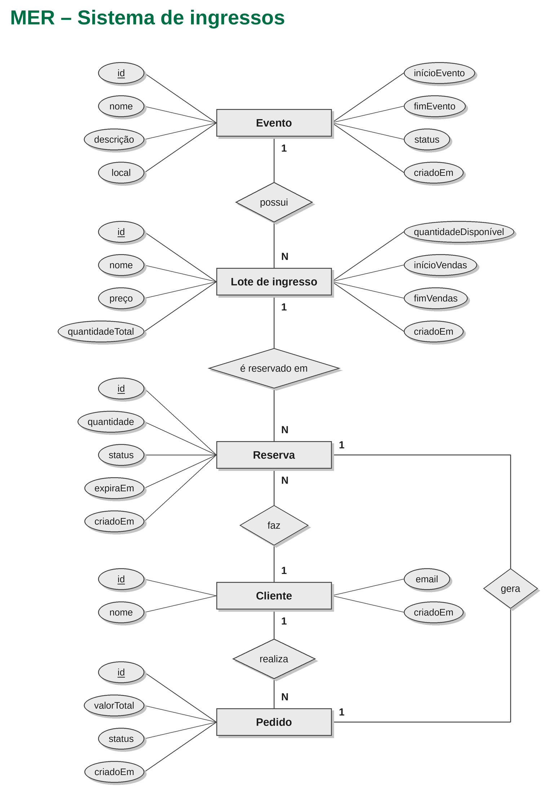
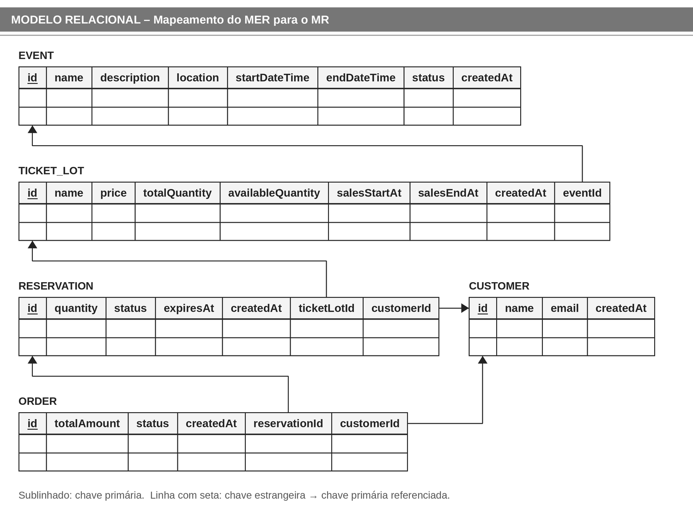

# TicketFlow API

## Objetivo
Desenvolver uma API para venda de ingressos de eventos, garantindo que o sistema não reserve nem venda mais ingressos do que o estoque disponível, mesmo quando várias pessoas tentarem comprar ao mesmo tempo.

## Tecnologias
- Java
- Spring Boot
- PostgreSQL
- Flyway
- Docker

## Funcionalidades
- [ ] Cadastro e consulta de eventos
- [ ] Cadastro de lotes de ingressos
- [ ] Consulta de disponibilidade
- [ ] Reserva temporária de ingressos
- [ ] Confirmação e cancelamento de reservas
- [ ] Expiração de reservas

## Modelagem do banco de dados
### Modelo Entidade-Relacionamento (MER)

### 📋 Entidades

- **Evento (`Event`):** representa o evento para o qual os ingressos serão vendidos, armazenando informações como nome, local e data.
- **Lote de ingressos (`TicketLot`):** representa um conjunto de ingressos de um evento, com preço, quantidade e período de venda próprios.
- **Cliente (`Customer`):** representa a pessoa que realiza reservas e compras.
- **Reserva (`Reservation`):** registra a quantidade de ingressos que um cliente reservou temporariamente e o prazo para confirmar a compra.
- **Pedido (`Order`):** representa a compra confirmada, associada à reserva que a originou.

### Modelo Relacional (MR)

